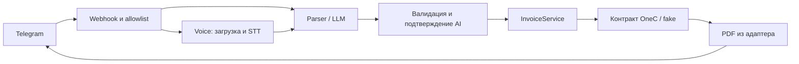

# Счета через Telegram и 1С

Текст и голос → проверенная команда → стандартный счёт в 1С → PDF в Telegram.
**Сейчас 1С — fake. Реальный финансовый MVP ещё не подтверждён.**
Telegram и OpenAI проверены с подменой внешних ответов. Реальные голосовые сообщения
через настоящий OpenAI и Telegram ещё требуют ручной проверки.

## Что работает локально

- Авторизация по Telegram user ID, личные чаты, защищённый webhook.
- Строгие текстовые команды без AI; свободные формулировки через LLM при включении AI.
- Загрузка voice, STT, общий текстовый pipeline. Голос и LLM требуют подтверждения.
- Fake 1С: найти контрагента по обычному названию, зафиксировать стабильный ID,
  проверить revision, создать/найти документ, провести, получить тестовый PDF.
- Повторы, таймауты, неоднозначность, частичные ошибки и ограниченная повторная доставка.
- Pydantic на границах данных, SecretStr, безопасные JSON-логи.



Один процесс Python, FastAPI/Pydantic, HTTPX, официальный OpenAI SDK, Uvicorn;
pytest для тестов. БД, очередей и новых сервисов нет. Справочники и расчёты остаются в 1С.

## Быстрый запуск без ключей

```powershell
python -m venv .venv
.\.venv\Scripts\python.exe -m pip install -r requirements-dev.txt
.\.venv\Scripts\python.exe scripts/demo.py
.\.venv\Scripts\python.exe -m pytest -q
.\.venv\Scripts\python.exe scripts/smoke.py
```

Demo запускает настоящий HTTP-сервер на loopback и проходит voice → STT → LLM →
подтверждение → fake 1С → PDF, затем повторяет update и команду текстом.
Все исходящие HTTP-вызовы подменены, секреты случайные и недействительные.
Ожидаемый результат: **1 документ, 1 доставка PDF, по 1 вызову STT и LLM**.
Сервер сам останавливается; PDF/аудио на диск не записываются.

## Подключение тестового Telegram-бота

Python 3.10+; фактически проверено на Windows / Python 3.10.6.
Для запуска без тестов достаточно `requirements.txt`.
Переменные задаются в окружении процесса; `.env` автоматически не загружается.
Список без секретов — в `.env.example`.

Если локальные значения хранятся в игнорируемом Git файле `.env.local`, загрузите
их в **каждом** PowerShell-окне, где запускаете приложение или регистрируете webhook:

```powershell
Get-Content .env.local | Where-Object { $_ -match '^[A-Za-z_][A-Za-z0-9_]*=' } | ForEach-Object {
    $name, $value = $_ -split '=', 2
    [Environment]::SetEnvironmentVariable($name, $value, 'Process')
}
```

| ENV | Значение |
|---|---|
| `APP_MODE` | Только `mock`; режим настоящей 1С запрещён до реализации адаптера |
| `ONEC_WRITE_ENABLED` | `false` по умолчанию; будущая запись в реальную 1С потребует явного `true` и отдельной проверки адаптера |
| `FAKE_ONEC_FAULT` | Только для ручной проверки recovery: `disabled`, `create_lost_response` или `post_lost_response` |
| `TELEGRAM_BOT_TOKEN` | Токен вашего тестового бота |
| `TELEGRAM_WEBHOOK_SECRET` | Независимый случайный секрет: 32–256 символов A–Z, a–z, 0–9, `_`, `-` |
| `TELEGRAM_ALLOWED_USER_IDS` | Положительные числовые user ID через запятую |
| `AI_MODE` | `disabled` по умолчанию; `openai` включает LLM и STT |
| `OPENAI_API_KEY` | Обязателен при `AI_MODE=openai` |
| `OPENAI_LLM_MODEL` | `auto` по умолчанию; приложение выбирает доступную модель с Structured Outputs |
| `OPENAI_STT_MODEL` | `auto` по умолчанию; приложение выбирает доступную модель с JSON/logprobs |

```powershell
.\.venv\Scripts\python.exe -m uvicorn app.main:create_app --factory --host 127.0.0.1 --port 8000 --workers 1 --no-access-log
```

Нужен HTTPS-прокси к `/telegram/webhook`. Зарегистрируйте `setWebhook` с тем же
`secret_token`, `allowed_updates=["message", "callback_query"]` и `max_connections=1`
([Telegram Bot API](https://core.telegram.org/bots/api#setwebhook)).
Приложение не регистрирует webhook автоматически. На публичном прокси ограничьте
размер/скорость входящих запросов и не записывайте заголовки/тела в логи.

## Ручной E2E через настоящий Telegram в mock

Для этого теста нужны тестовый бот, его токен, ваш числовой Telegram user ID и
HTTPS-туннель/прокси. Локальный HTTP-порт нельзя указать Telegram напрямую.
Например, если установлен `cloudflared`, в отдельном окне запустите:

```powershell
cloudflared tunnel --url http://127.0.0.1:8000
```

Скопируйте выданный HTTPS-адрес и в окне приложения задайте окружение (подставьте
свои значения, токен и секрет не выводите в логи):

```powershell
$env:APP_MODE = "mock"
$env:ONEC_WRITE_ENABLED = "false"
$env:FAKE_ONEC_FAULT = "disabled"
$env:AI_MODE = "openai"
.\.venv\Scripts\python.exe -m uvicorn app.main:create_app --factory --host 127.0.0.1 --port 8000 --workers 1 --no-access-log
```

Проверка локального процесса и регистрация webhook выполняются из второго окна
(замените `https://PUBLIC_HOST` на адрес туннеля):

```powershell
Invoke-RestMethod http://127.0.0.1:8000/healthz
$hook = "https://PUBLIC_HOST/telegram/webhook"
$body = @{ url = $hook; secret_token = $env:TELEGRAM_WEBHOOK_SECRET;
           allowed_updates = @("message", "callback_query"); max_connections = 1 }
Invoke-RestMethod -Method Post -Uri ("https://api.telegram.org/bot{0}/setWebhook" -f $env:TELEGRAM_BOT_TOKEN) `
  -ContentType "application/json" -Body ($body | ConvertTo-Json -Compress)
```

В чате с ботом отправьте по порядку:

1. `/start` — бот показывает помощь и сообщает тестовый режим.
2. `Сформируй счёт для ООО Ромашка за сентябрь 2026` — бот должен отправить
   `mock-not-an-invoice.pdf` с пометкой `MOCK ONLY`; это демонстрационный PDF,
   финансовый документ в 1С не создаётся.
3. `Сформируй счёт для ООО Двойник за сентябрь 2026` — бот должен попросить
   уточнить клиента; PDF и документ не должны появиться.
4. `Сформируй счёт для ООО Договоры за сентябрь 2026` — бот должен попросить
   уточнить договор; документ не создаётся.

Голосовой тест требует `AI_MODE=openai` и ключ. В
`AI_MODE=disabled` намеренно работает только строгая текстовая команда.
После голосовой или свободной текстовой команды бот показывает распознанные данные
и кнопки «Подтвердить» / «Отмена». Нажатие первой возвращает тестовый PDF;
вторая завершает запрос без создания документа. Код вручную вводить не нужно.

Для реального OpenAI в том же mock-режиме 1С перед запуском процесса задайте:

```powershell
$env:AI_MODE = "openai"
```

Официальный SDK включается только в обычном процессе без тестового `ai_transport`;
вызовы Structured Outputs возвращают типизированную `InvoiceCommand`, а STT —
проверенный `Transcript`. Контракт fake/настоящей 1С от этого не меняется.
При первом вызове OpenAI приложение читает список моделей, доступных ключу, и
запоминает выбор на время работы процесса: для команды `gpt-5-mini`, затем
`gpt-4o-mini`; для голоса `gpt-4o-mini-transcribe`, затем `gpt-4o-transcribe`.
Если нет поддерживаемой модели или список недоступен, операция безопасно
останавливается. Выбор модели не влияет на проверку команды и подтверждение.

### Безопасное воспроизведение дубля webhook

Это повторяет один и тот же payload на локальном защищённом endpoint, не создавая
новое Telegram-сообщение. Выполняйте при `FAKE_ONEC_FAULT=disabled`; значения
`$env:TELEGRAM_ALLOWED_USER_IDS` и секрета должны совпадать с процессом:

```powershell
$update = @{ update_id = 900001; message = @{
  message_id = 900001; from = @{ id = [int64]$env:TELEGRAM_ALLOWED_USER_IDS; is_bot = $false };
  chat = @{ id = [int64]$env:TELEGRAM_ALLOWED_USER_IDS; type = "private" };
  text = "Сформируй счёт для ООО Ромашка за сентябрь 2026"
} } | ConvertTo-Json -Depth 8 -Compress
$headers = @{ "X-Telegram-Bot-Api-Secret-Token" = $env:TELEGRAM_WEBHOOK_SECRET }
Invoke-RestMethod -Method Post -Uri http://127.0.0.1:8000/telegram/webhook -Headers $headers `
  -ContentType "application/json" -Body $update
Invoke-RestMethod -Method Post -Uri http://127.0.0.1:8000/telegram/webhook -Headers $headers `
  -ContentType "application/json" -Body $update
```

Оба запроса должны вернуть `{"ok":true}`; в Telegram придёт одна доставка PDF,
а в логах останется одна операция и один `document_id`. Изменение текста при том
же `update_id` должно вернуть HTTP 409 и не запускать новую операцию.

### Потерянный ответ fake 1С и recovery

Остановите приложение, задайте fault и запустите его снова:

```powershell
$env:FAKE_ONEC_FAULT = "create_lost_response"  # или post_lost_response
.\.venv\Scripts\python.exe -m uvicorn app.main:create_app --factory --host 127.0.0.1 --port 8000 --workers 1 --no-access-log
```

Отправьте обычную команду из шага 2. При `create_lost_response` fake создаст один
черновик и потеряет ответ; бот сообщит, что проведение не завершено. При
`post_lost_response` документ будет проведён, но ответ потеряется; бот сообщит,
что PDF ещё не получен. В обоих случаях отправьте `/retry`.

`/retry` сначала читает фактическое состояние fake 1С и продолжает ту же frozen
операцию по `client_id`, revision и operation ID. Ожидается один PDF, один и тот
же `document_id` в логах и `len(documents) == 1` в offline-тесте; второй документ
создаваться не должен. Fault одноразовый, поэтому повторный `/retry` безопасен.
После проверки верните `$env:FAKE_ONEC_FAULT = "disabled"` и перезапустите процесс.

Для снятия webhook после теста:

```powershell
Invoke-RestMethod -Method Post -Uri ("https://api.telegram.org/bot{0}/deleteWebhook" -f $env:TELEGRAM_BOT_TOKEN)
```

## Команды и AI

`/start`, `/help` — помощь; кнопка «Отмена» отменяет ожидающее подтверждение;
`/retry` — восстановление незавершённой операции после проверки её состояния в 1С.

**Сформируй счёт для ООО Ромашка за сентябрь 2026** — строгая команда без LLM.
**Выстави, пожалуйста, счёт ООО Ромашка за сентябрь 2026** — пример для LLM.
Без года бот просит уточнение. Цены, услуги, договоры и реквизиты AI не определяет.

LLM получает только текст и JSON Schema, без tools или доступа к 1С. Приложение
валидирует результат, запрещает лишние поля и сверяет клиента/месяц/год с текстом.
Затем показывает команду с кнопками «Подтвердить» и «Отмена» на 5 минут.
Скрытый одноразовый токен кнопки связан с пользователем; другая команда заменяет ожидающее подтверждение.
Схема и фильтр сами по себе не гарантируют правильность смысла, поэтому AI/голос
не запускают запись без явного подтверждения человека.

Voice: OGG/Opus, до 120 секунд и 4 МБ, проверка MIME/заголовка/размера и безопасного
пути файла. В SDK-пути OpenAI содержимое записывается в одноразовый временный файл
только на время multipart-запроса и удаляется в `finally`; в offline/mock transport
аудио остаётся в памяти. Пустой, длинный или неуверенный
результат отклоняется. Порог logprobs — консервативная эвристика, не гарантия качества.
Низкая уверенность: средний logprob < -1 или любой токен < -3. Без logprobs — отказ.

В production-режиме OpenAI вызывается официальным Python SDK: `responses.parse`
возвращает `InvoiceCommand` через `output_parsed`, а транскрипция использует
`audio.transcriptions.create`. Реализация сверена с [Structured Outputs](https://developers.openai.com/api/docs/guides/structured-outputs)
и [Transcriptions API](https://developers.openai.com/api/reference/cli/resources/audio/subresources/transcriptions/methods/create).
При включении OpenAI текст/аудио передаются этому провайдеру. Responses использует
`store=false`; это не обещание полного отсутствия хранения на стороне провайдера.

## Повторы, ошибки и ограничения стенда

- Название компании используется только для `resolve_client`. После поиска в памяти
  остаются `client_id`, `BillingBasis.key` и revision; повторный `/retry` не ищет
  компанию по новому тексту. Стабильный operation ID не зависит от update/user ID.
  Уникальность документа должна обеспечиваться атомарно в 1С; fake делает это в памяти.
- Перед `ensure_draft` и `ensure_posted` адаптер обязан проверить актуальность
  revision атомарно с записью. Если данные изменились, операция останавливается.
- Повтор одного update не повторяет завершённую обработку. Изменённое содержимое
  под тем же update ID — HTTP 409. После сбоя доставки STT/LLM не запускаются снова.
- Для доставки максимум три попытки на update; затем HTTP 503 и запись в логе
  требуют вмешательства оператора. После подтверждённой доставки повторное
  нажатие или новая команда по тому же operation ID не отправляют второй PDF
  тому же пользователю.
- `sendDocument` запускается не более одного раза для пары user ID / operation ID
  в текущем процессе. Если ответ Telegram потерян, доставка считается неизвестной:
  автоматический повтор PDF запрещён, бот просит проверить чат и обратиться к
  оператору. Это может означать отсутствие файла; без подтверждения нельзя
  одновременно гарантировать доставку и отсутствие дубля.
- Ошибка 1С сообщает, что именно не завершено: создание, проведение или PDF.
  После timeout/разрыва сервис сначала читает `read_operation`; состояние `unknown`
  блокирует новую запись. Пользователь получает `/retry`, который продолжает только
  подтверждённый `client_id` и прежний operation ID.
- После доставки квитанция хранит ID, fingerprint и счётчик; временные команда/ответ
  удаляются. До доставки они нужны для безопасного повтора. Аудио/PDF не кэшируются.
- Лимит 10 000 квитанций: новые update отклоняются с 503, старые записи не вытесняются.
- Только один процесс. После перезапуска fake-документы, квитанции, подтверждения
  и история доставки PDF теряются. Постоянная идемпотентность production пока
  не реализована/не проверена.
- Webhook 32 КиБ / 5 секунд на чтение; исходящий JSON 64 КиБ; полный HTTP-дедлайн
  20 секунд, STT 45 секунд; сетевой таймаут чтения может сработать раньше.

## Где продолжать

`app/domain.py` — модели и контракт 1С; `app/service.py` — финансовый сценарий;
`app/bot.py` — общий pipeline и подтверждения; `app/ai.py` / `app/voice.py` — AI;
`app/telegram.py` — HTTP; `app/main.py` — webhook и авторизация.

Fake содержит только фикстуры: `ООО Ромашка`, неоднозначные `ООО Двойник` и
`ООО Договоры`. Возвращаемый статический PDF помечен `MOCK ONLY`, это не счёт.

Запись в настоящую 1С защищена явным флагом и сейчас отключена. Для настоящей 1С нужны конфигурация/версия, документация API, тестовая база,
минимальные права, источник строк/цен, гарантии идемпотентности и способ штатной
печати. Подробности и последовательность проверки — [контракт 1С](docs/onec-contract.md).
Без них этапы подключения реальной 1С и реального E2E остаются незавершёнными.

Тесты покрывают parsing/schema, LLM/STT/Telegram, частичные сбои, конкурентность,
повторы и утечки секретов. Проверка зависимостей: `python -m pip check`.
Есть предупреждение Starlette о будущем прекращении поддержки HTTPX в TestClient;
оно относится к тестовому клиенту, не скрывается и не мешает текущим тестам.
